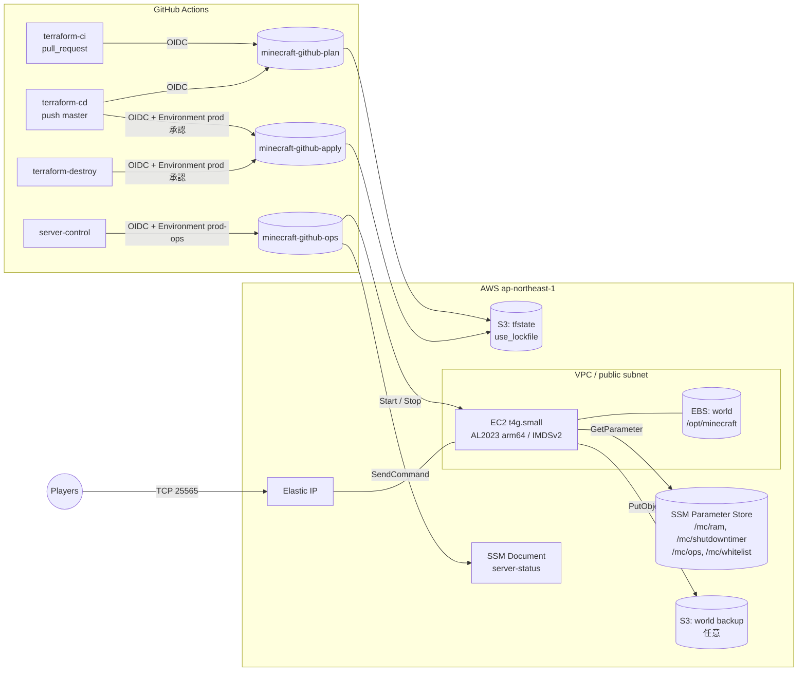

# game-server-infra

AWS 上の Minecraft Java サーバーを Terraform と GitHub Actions で構築・運用するリポジトリです。

次の AWS 公式ブログの構成を IaC にしたうえで、いくつかの点を改善しています（「[ブログとの差分](#ブログとの差分)」を参照）。

- [Setting up a Minecraft Java server on Amazon EC2](https://aws.amazon.com/blogs/gametech/setting-up-a-minecraft-java-server-on-amazon-ec2/)
- [Cost optimize your Minecraft Java EC2 server](https://aws.amazon.com/blogs/gametech/cost-optimize-your-minecraft-java-ec2-server)
- [aws-samples/cost-optimize-minecraft-server-on-ec2](https://github.com/aws-samples/cost-optimize-minecraft-server-on-ec2)

## 構成



### サーバー内の動き

| ユニット | 役割 |
| --- | --- |
| `minecraft.socket` | `/run/minecraft.stdin`（FIFO）をサーバーの標準入力にする |
| `minecraft.service` | `/mc/ram` を読んで `java -Xms -Xmx -jar server.jar nogui` を起動する。`eula=true` でなければ起動しない（`ExecCondition`）。停止時は stdin に `stop` を送って正常終了を待つ |
| `minecraft-players.service` | `minecraft.service` と一緒に起動し、起動完了（`Done`）を待ってから、`/mc/ops` と `/mc/whitelist`（SecureString）のプレイヤーに `op` / `whitelist add` を送る |
| `monitor_minecraft.service` | 60 秒ごとに 25565 番ポートの接続数を確認し、無人のまま `/mc/shutdowntimer` 秒たったらサーバーを止め、（有効なら）バックアップを取ってから OS を停止する。OS が止まると EC2 は stopped になる |
| `minecraft-backup.timer` | 有効な場合のみ。日次でワールドを S3 にバックアップする（`Persistent=true` なので、停止中に時刻を過ぎた分は次の起動時に実行される） |

### ディレクトリ構成

```
.
├── bootstrap/                  # tfstate 用 S3、GitHub OIDC、IAM ロール（最初に一度だけローカルで apply）
├── modules/
│   ├── network/                # VPC / パブリックサブネット / IGW / ルートテーブル（既定 VPC も選べる）
│   ├── security_group/         # 25565（全公開）と 22（Instance Connect の CIDR のみ）
│   ├── iam/                    # インスタンスロール（SSM Core と /mc/* の読み取り）
│   ├── ssm_parameters/         # /mc/ram、/mc/shutdowntimer、/mc/ops・/mc/whitelist（SecureString、値は手動）
│   ├── minecraft_server/       # EC2、ワールド用 EBS、EIP、user data（templatefile）、status 用 SSM ドキュメント
│   │   └── templates/
│   └── world_backup/           # バックアップ用 S3 とアップロード権限（任意）
├── envs/
│   └── prod/                   # ルートモジュール（backend.tf / main.tf / variables.tf / terraform.tfvars）
├── .github/workflows/          # terraform-ci / terraform-cd / server-control / terraform-destroy
├── .tflint.hcl
└── mise.toml                   # Terraform のバージョン（ローカルと CI で共通）
```

ご提示の構成から変えた点は次の 3 つです。

- `modules/world_backup` を追加しました。バックアップを有効にしたときだけ `count` で作られます。
- ワールドはルート EBS ではなく、別の EBS に置いています。AMI の更新や Minecraft のバージョンアップでインスタンスを作り直しても、ワールドは消えません。
- status 用の SSM ドキュメントは `minecraft_server` モジュールの中に置きました。サーバーの実装（ポートなど）と一緒に変わるためです。

## 前提

ワークフローは既定ブランチ `master` を対象にしています。`main` に名前を変える場合は、`.github/workflows/*.yml` の `master` と bootstrap の `github_default_branch` を書き換えてください。


| 種類 | 内容 |
| --- | --- |
| AWS | 管理者相当の権限でローカルから操作できる AWS アカウント（bootstrap にだけ使う） |
| GitHub | このリポジトリと、Environments を使えるプラン（public リポジトリ、または有料プランの private リポジトリ） |
| ローカルのツール | [mise](https://mise.jdx.dev/)（`mise install` で `mise.toml` の Terraform が入る）、AWS CLI v2、GitHub CLI（`gh`）。任意で tflint 0.65.0 と trivy。サーバーにファイルを送る場合は [Session Manager plugin](https://docs.aws.amazon.com/systems-manager/latest/userguide/session-manager-working-with-install-plugin.html) |

## 1. bootstrap（最初に一度だけローカルで実行）

```bash
cd bootstrap
cp terraform.tfvars.example terraform.tfvars   # github_owner / github_repository を確認する
# アカウント ID は個人情報として扱い、コミットしない（*.auto.tfvars は .gitignore 済み）
echo 'allowed_account_ids = ["<AWS アカウント ID>"]' > local.auto.tfvars
export AWS_PROFILE=<個人アカウントのプロファイル>
terraform init
terraform plan -out=tfplan
terraform apply tfplan
```

`allowed_account_ids` を設定すると、ほかのアカウントの認証情報で実行したときに plan の段階でエラーになります。誤ったアカウントに作ってしまう事故を防げます。

作られるものは次のとおりです。

- tfstate 用の S3 バケット：バージョニング、SSE-S3、パブリックアクセスブロック、TLS 必須、`prevent_destroy`
- GitHub Actions 用の OIDC プロバイダ：アカウントに既にある場合は `create_github_oidc_provider = false` にしてください
- IAM ロール 3 つ：

| ロール | 信頼する `sub` | 権限 |
| --- | --- | --- |
| `minecraft-github-plan` | `repo:<owner>/<repo>:pull_request`、`repo:<owner>/<repo>:ref:refs/heads/master` | `ReadOnlyAccess` から S3 オブジェクト、SSM パラメータ、シークレットの読み取りを Deny で除いたもの（state の読み取りは許可） |
| `minecraft-github-apply` | `repo:<owner>/<repo>:environment:prod` | 東京の EC2、`minecraft-prod-*` の IAM / S3 / SSM、`/mc/*`。IAM ロールは permissions boundary を付けたものしか作れない |
| `minecraft-github-ops` | `repo:<owner>/<repo>:environment:prod-ops` | `Project=minecraft, Environment=prod` タグのインスタンスの Start / Stop と、status ドキュメントの実行 |

- `minecraft-instance-boundary`：インスタンスロールに付ける permissions boundary

bootstrap の state はローカルの `bootstrap/terraform.tfstate` に残ります（`.gitignore` 済み）。この state をなくすと bootstrap を変更できなくなるので、安全な場所に保管してください。

### GitHub 側の設定

1. apply の出力 `github_secrets_commands`（`terraform output -raw github_secrets_commands`）をそのまま実行し、リポジトリの **Secrets** に登録します。どの値にもアカウント ID が含まれるため、Variables ではなく Secrets にしています（Secrets はログでマスクされます）。

   | Secret | 値 |
   | --- | --- |
   | `AWS_ACCOUNT_ID` | AWS アカウント ID（`allowed_account_ids` と、ログ・コメントの伏せ字に使う） |
   | `TF_STATE_BUCKET` | `state_bucket_name` |
   | `AWS_PLAN_ROLE_ARN` | `plan_role_arn` |
   | `AWS_APPLY_ROLE_ARN` | `apply_role_arn` |
   | `AWS_OPS_ROLE_ARN` | `ops_role_arn` |

   リージョンを変える場合だけ、Variables に `AWS_REGION` を登録します（既定は `ap-northeast-1`）。

2. **Settings → Environments** で次の 2 つを作ります。
   - `prod`：**Required reviewers** に自分を追加し、**Deployment branches** を `master` だけに制限します。apply と destroy はこの承認を経ないと実行されません。
   - `prod-ops`：承認者は付けず、**Deployment branches** を `master` だけに制限します。server-control が使います。
3. **Settings → Branches** で `master` にブランチ保護（または Ruleset）を設定し、PR を必須にします。必須のチェックには `fmt / validate / tflint / trivy` と `plan (prod)` を指定することをおすすめします。
4. （任意）Discord に起動・停止を通知したい場合は、Environment `prod-ops` の **Secrets** に `DISCORD_WEBHOOK_URL` を登録します。登録しなければ通知のステップは実行されません。

## 設定値と秘密情報の置き場所

このリポジトリは public です。値ごとに「公開されても困らないか」と「誰がいつ使うか」で、置き場所を分けています。

| 種類 | 置き場所 | 例 | 変更方法 |
| --- | --- | --- | --- |
| 公開されても困らない設定値 | `envs/prod/terraform.tfvars`（コミットする） | インスタンスタイプ、バージョン、メモリ、`accept_eula` | PR で変更し、CD で apply |
| アカウント ID と、それを含む値 | GitHub Secrets（ローカルでは gitignore 済みの `*.auto.tfvars`） | `AWS_ACCOUNT_ID`、state バケット名、ロール ARN | `gh secret set` |
| ワークフローが使う秘密情報 | GitHub Secrets（Environment `prod-ops`） | `DISCORD_WEBHOOK_URL` | `gh secret set --env prod-ops` |
| サーバーが使う個人情報・秘密情報 | SSM パラメータストア（SecureString） | `/mc/ops`、`/mc/whitelist`（プレイヤー名） | **手動**（下記） |

### SSM パラメータ（SecureString）の扱い

- Terraform は `value_wo`（write-only 引数）を使い、`dummy` という値でパラメータを作るだけです。値は tfstate に保存されません。また、`value_wo_version` を変えない限り、apply しても手動で入れた値は上書きされません。
- サーバーは `dummy` を「未設定」として扱います。
- 値はプレイヤー名のカンマ区切りです。Java 版のユーザー名の形式（英数字と `_`、3〜16 文字）以外の名前は、コンソールへのコマンド注入を防ぐために無視します。

```bash
# op を付けるプレイヤー
aws ssm put-parameter --name /mc/ops --type SecureString --overwrite --value "PlayerA"
# ホワイトリスト（設定すると whitelist on になる。dummy に戻しても自動では off にならない）
aws ssm put-parameter --name /mc/whitelist --type SecureString --overwrite --value "PlayerA,PlayerB,PlayerC"
```

値はサーバーが次に起動したときに反映されます。すぐに反映したい場合は、稼働中のサーバーで `sudo systemctl restart minecraft-players` を実行します。反映は追加だけです。リストから消したプレイヤーは、`sudo mc-cmd deop <player>` や `sudo mc-cmd whitelist remove <player>` で手動で外してください。

### 注意点

- **アカウント ID は個人情報として扱い、公開される場所に出さないようにしています。**
  - コード：`allowed_account_ids` は変数にし、値はリポジトリに置きません。
  - Actions のログ：アカウント ID を含む値はすべて Secrets から渡し、`mask-aws-account-id: true` で以降のログをマスクします。
  - PR コメントと Job summary：ログのマスクが効かないため、書き出す前にアカウント ID を `************` に置き換えます。
  - plan ファイル：state が丸ごと入るため、artifact で受け渡しません。apply ジョブで作り直します。
- PR に投稿される plan のコメントは公開されます（IP、リソース名など）。SecureString の値は write-only なので、plan には出ません。
- SecureString は AWS 管理キー（`aws/ssm`）で暗号化しています。KMS の追加料金はかかりません。plan ロールは `/mc/*` を読めるため、同じリポジトリのブランチからの PR では復号できます。public リポジトリでも、ブランチを push できるのはコラボレーターだけなので、許容しています。

## 2. デプロイから接続確認まで

1. [Minecraft EULA](https://aka.ms/MinecraftEULA) を読み、同意する場合は `envs/prod/terraform.tfvars` の `accept_eula` を `true` にします。
2. ブランチを切って PR を作ると、`terraform-ci` が fmt / validate / test / tflint / trivy / plan を実行し、plan の結果を PR にコメントします。
3. PR を master にマージすると、`terraform-cd` の plan が走り、続く `apply (prod)` ジョブが承認待ちになります。Actions の画面で plan の内容（Job summary）を確認して承認します。
4. apply の Job summary に `server_address`（例: `203.0.113.10:25565`）が表示されます。
5. 初回起動は、パッケージのインストールと server.jar のダウンロード、ワールドの生成で 5〜10 分ほどかかります。Minecraft Java Edition の「マルチプレイ → サーバーを追加」に `server_address` を入れて接続します。

ローカルから plan を見たい場合は次のように実行します。

```bash
cd envs/prod
echo 'allowed_account_ids = ["<AWS アカウント ID>"]' > local.auto.tfvars   # コミットしない
terraform init -backend-config="bucket=<TF_STATE_BUCKET>"
terraform plan -lock=false
```

### うまく起動しないとき

Instance Connect か Session Manager でログインし、次を確認してください。

```bash
sudo tail -n 100 /var/log/cloud-init-output.log   # user data の実行ログ
systemctl status minecraft monitor_minecraft
journalctl -u minecraft -n 100 --no-pager
```

## 3. サーバーの操作

### 起動・停止・状態確認（server-control）

**Actions → server-control → Run workflow** で `start` / `stop` / `status` を選んで実行します。

- `start`：インスタンスを起動し、接続先を表示します。誰も接続しないまま `/mc/shutdowntimer`（既定 900 秒）たつと、自動的に停止します。
- `stop`：EC2 を停止します。OS のシャットダウン中に `minecraft.service` の ExecStop が `stop` コマンドを送るので、ワールドは保存されます。
- `status`：インスタンスの状態、接続先、サービスの状態、接続人数を表示します。

GitHub CLI からも実行できます。

```bash
gh workflow run server-control.yml -f action=start
```

### ログイン方法

- **EC2 Instance Connect**：マネジメントコンソールの EC2 → インスタンス → 接続 → EC2 Instance Connect から、`ec2-user` でログインします。
- **Session Manager**：`aws ssm start-session --target <instance_id>` でログインします。22 番を開けずに使えるので、`enable_ssh = false` でも利用できます。

### コンソールコマンド（op の付与など）

`mc-cmd` は、稼働中のサーバーの標準入力にコマンドを送るヘルパーです。op や whitelist を毎回の起動で反映したい場合は、[SSM パラメータ](#ssm-パラメータsecurestringの扱い)を使ってください。

```bash
sudo mc-cmd op <player>
sudo mc-cmd whitelist add <player>
sudo mc-cmd say hello
```

### server.properties の変更

```bash
sudo systemctl stop monitor_minecraft     # 作業中に自動停止しないようにする
sudo systemctl stop minecraft             # stop を送って保存してから終了する
sudo -u minecraft vi /opt/minecraft/server/server.properties
sudo systemctl start minecraft
sudo systemctl start monitor_minecraft
```

`server-port` は user data が `minecraft_port` の値で上書きします。ポートを変える場合は Terraform の `minecraft_port` を変更してください。

### ワールドのアップロード

ローカルからの SSH は、セキュリティグループで許可していません。Instance Connect で一時的な公開鍵を送り、Session Manager 経由で scp します。

```bash
INSTANCE_ID=$(terraform -chdir=envs/prod output -raw instance_id)
aws ec2-instance-connect send-ssh-public-key --instance-id "$INSTANCE_ID" \
  --instance-os-user ec2-user --ssh-public-key file://~/.ssh/id_ed25519.pub   # 鍵は 60 秒だけ有効
scp -o ProxyCommand="aws ssm start-session --target %h --document-name AWS-StartSSHSession --parameters portNumber=%p" \
  world.tar.gz "ec2-user@$INSTANCE_ID:/tmp/"
```

送ったあとはサーバー上で次のように展開します。

```bash
sudo systemctl stop monitor_minecraft minecraft
cd /opt/minecraft/server
sudo mv world "world.bak.$(date +%Y%m%d%H%M%S)"
sudo tar -xzf /tmp/world.tar.gz -C /opt/minecraft/server     # world/ ディレクトリが展開される想定
sudo chown -R minecraft:minecraft /opt/minecraft/server
sudo systemctl start minecraft monitor_minecraft
```

### よく変える設定

| やりたいこと | 方法 |
| --- | --- |
| メモリ・自動停止時間を変える | `jvm_memory_mb` / `shutdown_timer_seconds` を変えて apply すると、SSM パラメータが更新されます。サーバーの次回起動時から反映されます |
| Minecraft のバージョンを上げる | `minecraft_version` を変えて apply します。user data が変わるのでインスタンスは作り直されますが、ワールド用 EBS はそのまま引き継がれます |
| AMI を更新する | `ignore_changes = [ami]` にしているため、自動では更新しません。`terraform apply -replace=module.minecraft_server.aws_instance.this` を実行するか、バージョンアップに合わせて作り直してください |
| op / whitelist のプレイヤーを変える | SSM の `/mc/ops` / `/mc/whitelist` を手動で更新します（[置き場所](#設定値と秘密情報の置き場所)を参照） |
| 自動停止を一時的に止める | `sudo systemctl stop monitor_minecraft` を実行します（再起動すると元に戻ります） |
| バックアップを有効にする | `enable_backup = true` にします。保存先は出力の `backup_bucket_name` です |

## 4. コストの目安（東京リージョン、2026 年 10 月時点）

単価は [Amazon EC2 料金](https://aws.amazon.com/ec2/pricing/on-demand/)、[Amazon EBS 料金](https://aws.amazon.com/ebs/pricing/)、[Amazon VPC 料金（パブリック IPv4）](https://aws.amazon.com/vpc/pricing/) の公開価格から引用しました。料金は変わることがあるため、必ず公式ページで確認してください（**要確認**）。

| 項目 | 単価 | 課金されるとき |
| --- | --- | --- |
| t4g.small（オンデマンド） | 約 $0.0216 / 時間 | 起動中だけ |
| t4g.medium / t4g.large / r8g.large | 約 $0.0432 / $0.0864 / $0.142 / 時間 | 起動中だけ |
| T 系の CPU クレジット（unlimited の超過分） | 約 $0.04 / vCPU 時間 | 起動中、ベースラインを超えて使い続けたとき |
| パブリック IPv4（EIP を含む） | $0.005 / 時間（約 $3.65 / 月） | **EIP は停止中も常に課金**。EIP なしの自動割り当て IP は起動中だけ |
| EBS gp3（ルート 8GiB + ワールド 8GiB） | 約 $0.096 / GB 月（16GiB で約 $1.54 / 月） | **停止中も課金** |
| EBS スナップショット（destroy 時の final snapshot） | 約 $0.05 / GB 月 | 手動で消すまで |
| S3 バックアップ（任意） | 約 $0.025 / GB 月 | 保持期間中 |
| データ転送（インターネットへの送信） | 約 $0.114 / GB（毎月 100GB までは無料枠） | 通信量に応じて |

例えば t4g.small で 1 日 2 時間（月 60 時間）遊ぶと、次のくらいになります。

- EC2：60h × $0.0216 ≒ $1.30
- EIP：730h × $0.005 ≒ $3.65
- EBS：≒ $1.54
- **合計：約 $6.5 / 月**（データ転送を除く）

停止中もかかる費用は、EIP と EBS の約 $5.2 / 月です。EIP の分を節約したい場合は `use_eip = false` にできます。ただしその場合は起動のたびに IP が変わるので、server-control の `start` の結果で接続先を確認してください。

## 5. 削除

1. **Actions → terraform-destroy → Run workflow** を開き、`confirm` に `destroy-prod` と入力して実行します。Environment `prod` の承認が必要です。
   - `data_volume_final_snapshot = true`（既定）の場合、ワールド用 EBS のスナップショットが残ります。不要なら EC2 → スナップショットから削除してください。
   - バックアップが残っている S3 バケットは削除に失敗します。`backup_force_destroy = true` にして apply してから実行するか、バケットを手動で空にしてください。
2. bootstrap を削除します。state バケットには `prevent_destroy` を付けているので、先に `bootstrap/state_bucket.tf` の `prevent_destroy` を外し、バケットを空にしてから実行します。

   ```bash
   cd bootstrap
   terraform destroy
   ```

3. GitHub の Secrets と Environments（`prod` / `prod-ops`）を削除します。

## ブログとの差分

| 項目 | ブログ / aws-samples | このリポジトリ | 理由 |
| --- | --- | --- | --- |
| Java | `java-21-amazon-corretto-headless` 固定 | バージョン JSON の `javaVersion.majorVersion` に合わせて `java-<N>-amazon-corretto-headless` を入れる | Minecraft 26.x は Java 25 が必要で、Java 21 では起動しないため |
| server.jar | URL を直書き（例は 1.20.1） | `version_manifest_v2.json` からバージョンを解決し、sha1 を検証する | 改ざんや破損を検出でき、バージョンを変数で管理できるため |
| EULA | `sed` で無条件に true にする | `accept_eula = true` のときだけ true にする。false なら `ExecCondition` で起動しない | 同意を利用者の明示的な操作にするため |
| 停止 | 構築編は `kill -9`。コスト編は stdin に `/stop` を送るが、終了を待たない | ExecStop が stdin に `stop` を送り、プロセスの終了まで待つ | ワールドの保存が終わる前に強制終了されるのを防ぐため |
| 監視の間隔 | 記事は 60 秒、スクリプトの実装は 30 秒 | 60 秒 | 記事の記載に合わせた |
| 接続数の確認 | `netstat`（net-tools） | `ss`（iproute） | AL2023 の標準 AMI には net-tools が入っていない場合があるため（要確認） |
| EC2 の停止方法 | `shutdown -h now` | `systemctl poweroff` と `instance_initiated_shutdown_behavior = "stop"` | 方式はスクリプトと同じ OS 停止。IAM に `ec2:StopInstances` が要らないため、「自分だけを止められる権限」よりさらに権限を減らせる |
| 監視スクリプトの配布 | SSM Run Command で `deployment.sh` を取得して実行 | user data に組み込む（下記） | 一度の apply で完結し、実行するコードがリポジトリで管理されるため |
| ワールドの保存先 | ルート EBS 8GB | ルート 8GiB と、別のワールド用 EBS 8GiB | インスタンスを作り直してもワールドを残すため |
| SSH 鍵 | キーペアを作る | キーペアは作らない（Instance Connect / Session Manager を使う） | 鍵を管理しなくてよいため |
| 再起動の手段 | なし | `server-control` ワークフロー | 自動停止したあとに起動する手段が必要なため |
| IMDS / EBS | 既定のまま | IMDSv2 必須、EBS は暗号化 | セキュリティのベースラインとして |
| SSM の権限 | `AmazonSSMManagedInstanceCore` | 同じものに permissions boundary を付け、`ssm:GetParameter` を `/mc/*` に限定 | 最小権限にするため |
| op / whitelist | 手動でコンソールに入力 | SSM の SecureString（手動で設定）から起動のたびに反映 | 個人情報を public リポジトリに置かずに、宣言的に管理するため |

### 監視スクリプトを user data に組み込んだ理由（SSM ドキュメントとの比較）

| 観点 | user data（採用） | SSM ドキュメントと State Manager |
| --- | --- | --- |
| 実行のタイミング | 初回起動時に必ず実行され、サーバーの構築と同じ順序で動く | Association と実行順の管理が別途必要 |
| 変更の反映 | user data を変えるとインスタンスが作り直される（ワールドは別 EBS なので残る） | インスタンスを作り直さずに反映できる |
| 管理する場所 | templatefile 1 つにまとまる | ドキュメント、Association、権限が増える |

1 台のサーバーを、作り直しても問題ない構成で運用するため、構成要素が少ない user data を選びました。

## ローカルでの検証

```bash
terraform fmt -check -recursive
for d in bootstrap envs/prod; do terraform -chdir=$d init -backend=false && terraform -chdir=$d validate; done
terraform -chdir=envs/prod test                       # mock provider を使うので AWS 接続は不要
for d in modules/minecraft_server modules/ssm_parameters; do terraform -chdir=$d init -backend=false && terraform -chdir=$d test; done
tflint --init --config "$PWD/.tflint.hcl" && tflint --recursive --config "$PWD/.tflint.hcl"
trivy config --severity HIGH,CRITICAL .
```

trivy の指摘のうち意図して受け入れているものは、リソースの直前に `#trivy:ignore:<ID> 理由` の形で書いています（25565 の全公開、外向き通信の全許可、CMK を使わないこと、VPC フローログやアクセスログを取らないこと）。

## 参考

- [Terraform S3 backend（use_lockfile）](https://developer.hashicorp.com/terraform/language/backend/s3)
- [Configuring OpenID Connect in Amazon Web Services（GitHub Docs）](https://docs.github.com/en/actions/security-for-github-actions/security-hardening-your-deployments/configuring-openid-connect-in-amazon-web-services)
- [Managing environments for deployment（GitHub Docs）](https://docs.github.com/en/actions/managing-workflow-runs-and-deployments/managing-deployments/managing-environments-for-deployment)
- [Security hardening for GitHub Actions（SHA での固定）](https://docs.github.com/en/actions/security-for-github-actions/security-guides/security-hardening-for-github-actions)
- [Terraform: write-only arguments](https://developer.hashicorp.com/terraform/language/resources/ephemeral/write-only)
- [aws_ssm_parameter（value_wo）](https://registry.terraform.io/providers/hashicorp/aws/latest/docs/resources/ssm_parameter)
- [Permissions boundaries for IAM entities](https://docs.aws.amazon.com/IAM/latest/UserGuide/access_policies_boundaries.html)
- [AWS IP address ranges（EC2_INSTANCE_CONNECT）](https://docs.aws.amazon.com/vpc/latest/userguide/aws-ip-ranges.html)
- [Amazon Corretto 25 on Amazon Linux 2023](https://docs.aws.amazon.com/corretto/latest/corretto-25-ug/amazon-linux-install.html)
- [systemd.socket（ListenFIFO）](https://www.freedesktop.org/software/systemd/man/latest/systemd.socket.html)
