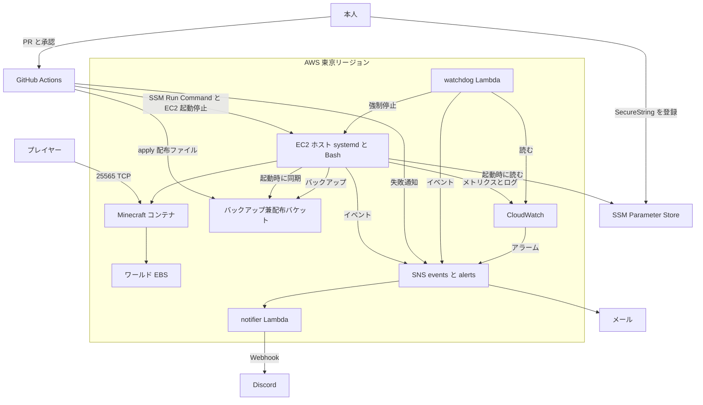
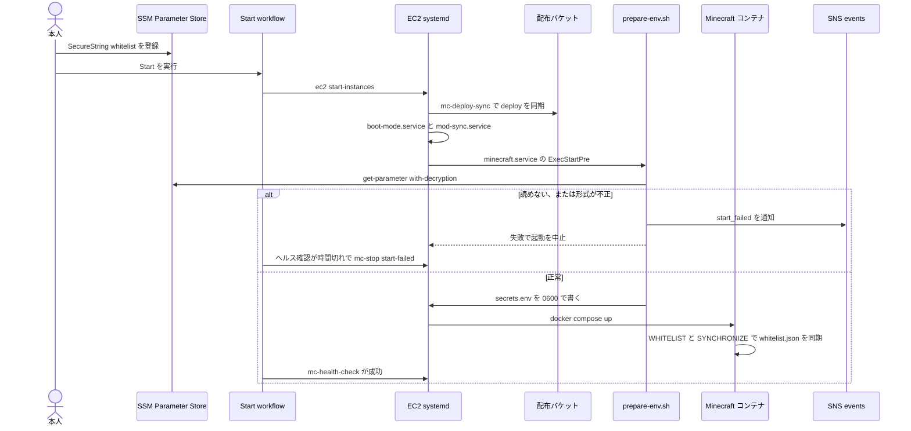
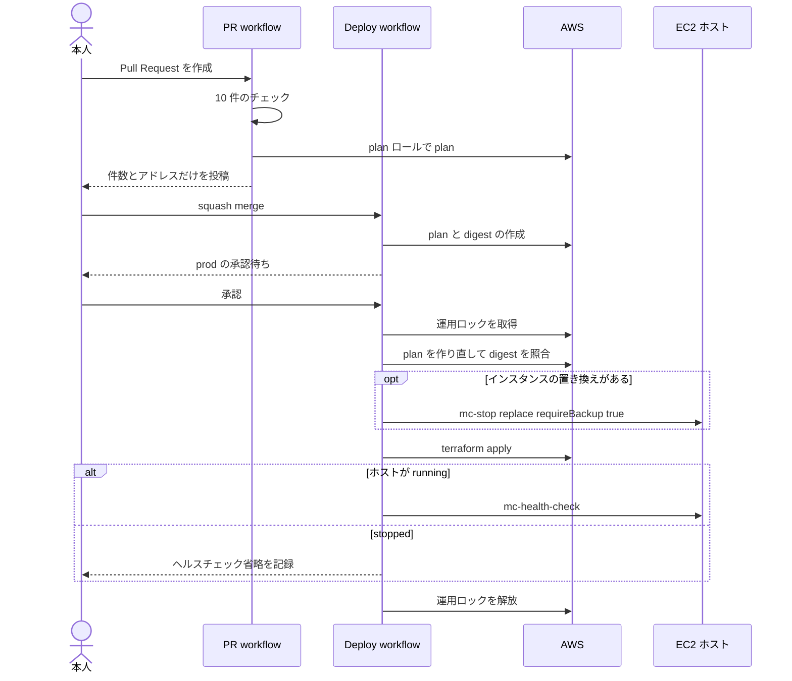
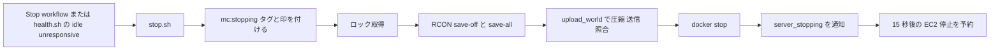
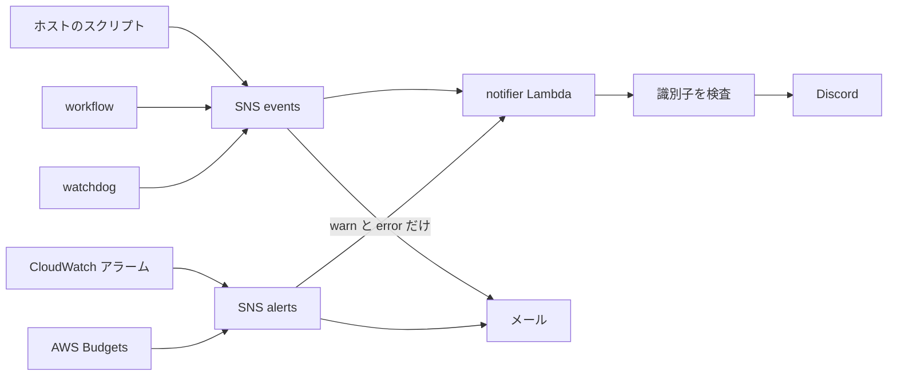

# Architecture

## Architecture Analysis

### System Overview

単一の EC2 ホスト上で Minecraft コンテナを動かす IaC リポジトリです。外から入るのは 25565/TCP だけで、管理は SSM で行います。GitHub Actions が plan、apply、運用操作を実行し、ホストはスクリプトと systemd で自律的に動きます。

### Architectural Style

**単一ホスト＋サーバーレスの補助**の構成です。

- ゲーム本体は EC2 上の 1 コンテナです。
- 通知と外部監視は Lambda です。
- 制御面は GitHub Actions で、OIDC で 3 つの CI ロール（plan、apply、ops）を使い分けます。
- 状態は 3 か所に分かれています。Terraform state と運用ロックは state バケット、ワールドはワールド EBS、バックアップと配布ファイルはバックアップバケットです。

### Component Relationships

テキストでの説明:

- プレイヤーは 25565/TCP でコンテナに接続します。
- 本人は SSM に SecureString を登録し、PR と承認で GitHub Actions を動かします。
- GitHub Actions は apply で配布ファイルをバケットへ置き、SSM Run Command と EC2 API でホストを操作します。
- ホストは起動時に配布ファイルと SSM パラメータを読み、コンテナを起動します。ワールドは EBS にあります。
- ホストはバックアップをバケットへ、メトリクスとログを CloudWatch へ、イベントを SNS へ送ります。
- watchdog は CloudWatch を読み、条件に当たればホストを止めて SNS へ通知します。
- SNS は notifier 経由で Discord へ、また直接メールへ届けます。

### Data Flow

| データ | 正の置き場 | 流れ |
|---|---|---|
| ゲーム設定 | `envs/prod/minecraft.json`（Git） | Terraform → S3 `deploy/minecraft.env` → ホスト `/opt/minecraft/` → コンテナの env |
| whitelist | SSM SecureString（本人が手で登録） | `prepare-env.sh` → `/etc/minecraft/secrets.env`（0600）→ コンテナの env → `/data/whitelist.json` |
| RCON パスワード | ワールド EBS の `.rcon-password`（ホストで生成） | `prepare-env.sh` → `secrets.env` → コンテナの env |
| Webhook URL | SSM SecureString（本人が手で登録） | notifier Lambda が実行時に読み、キャッシュします |
| ワールド | ワールド EBS `/srv/minecraft/data` | `tar --zstd` → S3 `hourly/`、`stop/` |
| 非公開の Terraform 入力 | CI は `TF_INPUTS_JSON`、手元は gitignore 済みファイル | `TF_VAR_*` と partial backend config |

### Key Design Decisions

- **秘匿値を Terraform に入れません。** whitelist と Webhook は本人が SSM に登録し、state と plan に現れません。テストで `minecraft.env` に `WHITELIST=` と `RCON_PASSWORD` が含まれないことを確認しています（`modules/minecraft_server/tests/minecraft_server.tftest.hcl:84-87`）。
- **user data を最小にします。** 16 KB の上限があるため、初回の導入とマウント、`mc-deploy-sync` の登録だけを行います。スクリプトとユニットは起動ごとに S3 から同期します（`user_data.sh.tftpl:59-74`）。
- **設定は次の起動から反映します。** apply しても動作中のホストには届きません（`deploy.tf:1-2`）。
- **承認した plan だけを適用します。** 承認後に plan を作り直し、digest を比較します（`scripts/cd/deploy.py:45-62,142-162`）。
- **最小権限と boundary を使います。** app ロールには boundary が必須です（`bootstrap/apply.tf:49`）。
- **失敗時は閉じます。** whitelist を読めない、または形式が不正なら起動を中止します（`prepare-env.sh:21-32`）。
- **データは `prevent_destroy` で守ります。** EIP、ワールド EBS、各バケットが対象です。

### 単一サーバーの前提

後続の複数サーバー化で影響を受ける箇所の記録です。設計はしていません。

| 前提 | 箇所 |
|---|---|
| 管理対象インスタンスはちょうど 1 台です | `scripts/cd/common.py:66-72` |
| SSM 文書名が接頭辞なしの固定名で、CI の権限もその名前に固定されています | `modules/minecraft_server/ssm.tf:5,13,18`、`bootstrap/iam.tf:14`、`scripts/cd/common.py:108` |
| メトリクスにサーバーを区別するディメンションがありません | `files/bin/common.sh:62-68`、`lambda/watchdog/watchdog.py:54`、`modules/monitoring/main.tf:5-33` |
| SSM パラメータの接頭辞が `/<prefix>/minecraft` に固定で、1 サーバー分です | `modules/minecraft_server/main.tf:22`、`envs/prod/main.tf:36` |
| リソース名が `<prefix>-minecraft`、`<prefix>-world`、`<prefix>-app-server` などで 1 組です | `modules/minecraft_server/main.tf`、`iam.tf` |
| バケット内のキーが `hourly/`、`stop/`、`deploy/` で、サーバーの区分がありません | `iam.tf:38-39`、`bootstrap/iam.tf:85`、`files/bin/backup-lib.sh:48` |
| workflow に対象サーバーの入力がなく、並行制御とロックが 1 つです | `.github/workflows/*.yml`（`minecraft-ops`、`minecraft-prod`）、`bootstrap/variables.tf:36-39` |
| Discord の Webhook が 1 つです | `envs/prod/main.tf:36`、`lambda/notifier/notifier.py:82-88` |
| ゲーム設定、Compose 定義、手順書が 1 つずつで、ポートとコンテナ名が固定です | `envs/prod/minecraft.json`、`docker/compose.yml:10,14`、`scripts/ci/client_guide.py:13-14` |
| 環境のルートモジュールと state キーが 1 つです | `envs/prod/`、`bootstrap/variables.tf:30-34` |

### Improvement Opportunities

- `code-quality-assessment.md` の技術的負債を参照してください。特に、起動を止める力を持つ `prepare-env.sh` にテストがない点は今回の作業に直接関わります。

## Interaction Diagrams

### プレイヤー一覧がサーバーへ届く流れ（whitelist）

今回の作業に最も関わる流れです。

テキストでの説明:

1. 本人が SSM に whitelist を登録し、Start workflow を実行します。
2. EC2 が起動し、`mc-deploy-sync` が配布ファイルを同期します。`boot-mode` と `mod-sync` が順に走ります。
3. `minecraft.service` の前処理として `prepare-env.sh` が SSM を読みます。
4. 読めない、または形式が不正なら `start_failed` を通知して起動を中止します。Start workflow はヘルス確認の時間切れ後に `start-failed` で停止します。
5. 正常なら `secrets.env` を書いてコンテナを起動します。コンテナは `WHITELIST` と `EXISTING_WHITELIST_FILE=SYNCHRONIZE` に従い `whitelist.json` を同期します。

復元モードでは `minecraft.service` が `ConditionPathExists` で起動せず、`prepare-env.sh` も走りません。

### 変更を本番へ適用する流れ

テキストでの説明:

1. PR で 10 件のチェックと plan を実行し、件数とアドレスだけを投稿します。
2. マージすると Deploy が plan と digest を作り、`prod` の承認を待ちます。
3. 承認後、運用ロックを取り、plan を作り直して digest を照合します。
4. インスタンスの置き換えがあれば、バックアップ必須で先に停止します。
5. apply 後、ホストが動いていればヘルスチェックを行います。これは動作中のプロセスへの確認で、配布したスクリプトの実行は確認しません。

### 停止とバックアップの流れ

テキストでの説明: 停止要求を受けた `stop.sh` は、タグと印を付けてロックを取り、保存、バックアップと照合、コンテナ停止、通知の順に進み、15 秒後の EC2 停止を予約します。`requireBackup=true` のときは保存や照合に失敗すると停止せずに失敗を返します。

### 通知の流れ

テキストでの説明: ホスト、workflow、watchdog は `events` へ、アラームと予算は `alerts` へ送ります。notifier は文面を作り、識別子が含まれていれば送信を中止して失敗にし、それ以外を Discord へ送ります。メール購読は Lambda と独立しており、`events` は warn と error だけが届きます。
