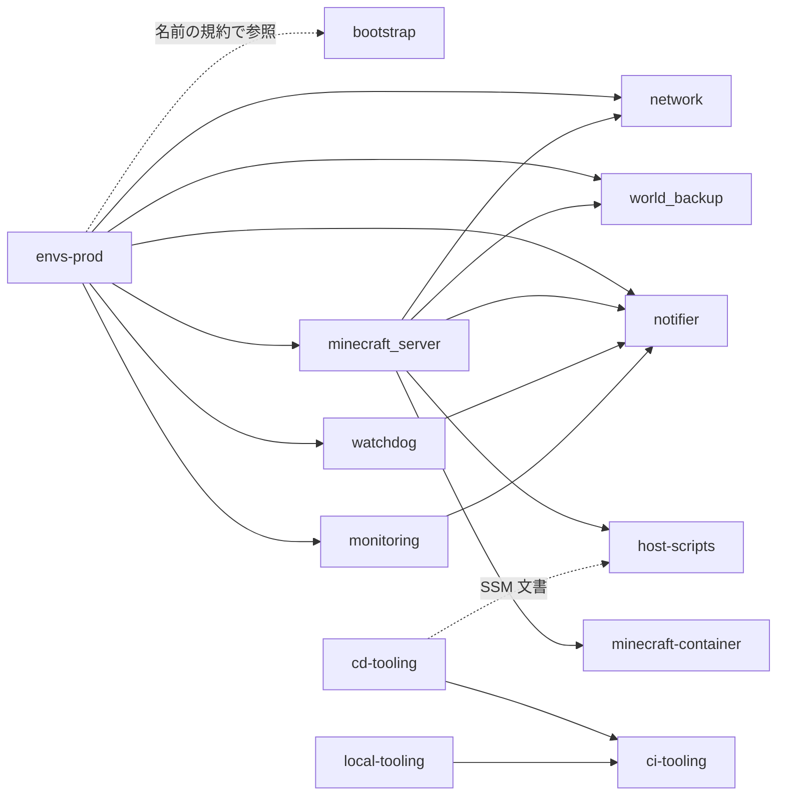

# Dependencies

版の一覧は `technology-stack.md` を参照してください。ここでは依存の向きと、失敗したときの影響を記録します。

## 内部依存

テキストでの説明:

- `envs-prod` が 6 モジュールを組み立てます。`minecraft_server` は `network`、`world_backup`、`notifier` の出力を受けます。`watchdog` と `monitoring` は `notifier` のトピックを受けます。
- `minecraft_server` は `files/` をホストへ配布し、`docker/compose.yml` を受け取ります。
- `cd-tooling` と `local-tooling` は `scripts/ci/plan.py` の関数を再利用します。

## 名前の規約による暗黙の依存

Terraform の参照では結ばれておらず、片方を変えるともう片方が壊れる依存です。

| 依存 | 両端 |
|---|---|
| boundary の ARN | `bootstrap/iam.tf:81` ⇔ `envs/prod/main.tf:14` |
| SSM パラメータの範囲 | `bootstrap/iam.tf:9`（`/<prefix>/*`）⇔ `modules/minecraft_server/main.tf:22` ⇔ `envs/prod/main.tf:36` |
| SSM 文書名 | `modules/minecraft_server/ssm.tf` ⇔ `bootstrap/iam.tf:14` ⇔ `scripts/cd/common.py:108` |
| 文書の上限と待ち時間 | `ssm.tf` ⇔ `scripts/cd/common.py:154-155`、`scripts/cd/operations.py:12` |
| events の発行元ロール名 | `modules/notifier/main.tf:11` ⇔ `bootstrap/iam.tf:64`、`modules/minecraft_server/iam.tf:14`、`modules/watchdog/main.tf:21` |
| events トピック名 | `modules/notifier/main.tf:9` ⇔ `bootstrap/iam.tf:58`、`scripts/local/prepare.py:118` |
| アラーム名 | `modules/monitoring/main.tf` ⇔ `lambda/notifier/notifier.py:20-23` |
| 関数名 | `modules/notifier/main.tf:13`、`modules/watchdog/main.tf:9` ⇔ `modules/monitoring/main.tf:67` |
| バックアップのキー形式 | `backup-lib.sh:48` ⇔ `ssm.tf:21`、`restore-apply.sh:12`、`scripts/cd/operations.py:15` |
| ランタイムのタグ | `stop.sh`、`scripts/cd/operations.py` ⇔ `modules/minecraft_server/main.tf:123`（`tests/ci/test_ci.py:194-196` で検査） |
| 起動順序 | `user_data.sh.tftpl`（`mc-deploy-sync`）⇔ `boot-mode.service` ⇔ `mod-sync.service` ⇔ `minecraft.service` |
| Compose の `env_file` | `docker/compose.yml:16,18` ⇔ `deploy.tf`（`minecraft.env`）、`prepare-env.sh:10`（`secrets.env`） |

## 外部依存

| 依存 | 使う場面 | 失敗時の影響 |
|---|---|---|
| Docker Hub（`itzg/minecraft-server`） | 初回または digest 変更時の取得 | 起動できません。イメージは EBS 上にキャッシュされます |
| Mojang / PlayerDB | コンテナ起動時の名前解決（既定は PlayerDB、公式ドキュメント） | 未確認です（要確認）。whitelist も同じ経路です |
| Minecraft のサーバーファイル配布元 | コンテナ起動時 | 起動できません |
| GitHub Releases（docker compose） | 初回起動のみ | 初回の user data が失敗します |
| MOD の配布元 | `mod-sync.sh`（キャッシュがない場合） | sha256 不一致や取得失敗で起動を中止します |
| Discord Webhook | 通知 | notifier が失敗します。メールは独立して届きます |
| GitHub Actions | デプロイと運用 | 手動の操作手段が止まります。自動停止はホストと watchdog で続きます |
| SSM Parameter Store | 起動ごとの whitelist 取得 | 起動を中止します（fail-closed） |
| S3 | 起動ごとの配布ファイル同期、バックアップ | 同期に失敗すると `boot-mode` 以降が起動しません |

## 依存の更新

- Dependabot の対象は `github-actions` だけです（`.github/dependabot.yml`）。
- `docker/compose.yml:1` のコメントと設定が一致していません。詳細は `code-quality-assessment.md` を参照してください。
- Terraform プロバイダーと CI ツールの更新は手動です。
