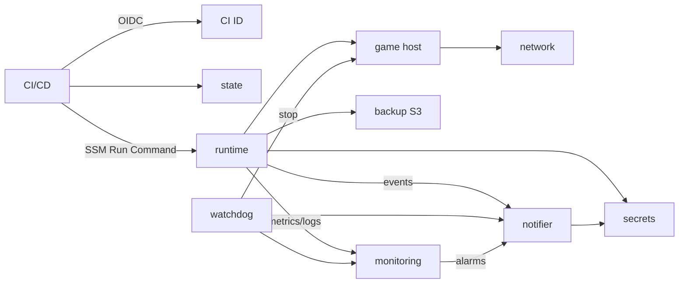

# Logical Components

上流: `aidlc/spaces/default/intents/261031-minecraft-aws-server/construction/nfr-requirements/` の 6 ファイル（performance / security / scalability / reliability / observability の各 requirements と tech-stack-decisions）。

infra スコープのため functional-design と domain-design は実行していません。そのため、構成要素は requirements.md と NFR Requirements から導いています。

## 構成要素の一覧

| ID | 構成要素 | 置き場所（Terraform） | 責務 | 障害の影響範囲 |
|---|---|---|---|---|
| LC1 | state バックエンド | `bootstrap/` | Terraform state を保存する S3（use_lockfile） | CI の plan / apply が止まる。ゲームは動き続ける |
| LC2 | CI 用 ID 基盤 | `bootstrap/` | GitHub OIDC プロバイダー、`${prefix}-ci-plan` / `-ci-apply` / `-ci-ops` ロール、permissions boundary | CI からの操作がすべて止まる。ゲームは動き続ける |
| LC3 | ネットワーク | `modules/network` | 専用 VPC、パブリックサブネット 1 つ、IGW、ルートテーブル。NAT なし、IPv4 のみ | サーバーに接続できない |
| LC4 | ゲームホスト | `modules/minecraft_server` | EC2（Graviton、オンデマンド）、インスタンスプロファイル（`${prefix}-app-*`）、SG（25565 のみ）、Elastic IP（`prevent_destroy`）、ワールド用 EBS（`prevent_destroy`）、user data | ゲームが止まる。ワールドは EBS とバックアップに残る |
| LC5 | ホスト上のランタイム | `modules/minecraft_server/files/`（user data で配置） | Docker と itzg コンテナ、systemd の unit / timer、Bash スクリプト（mod-sync / health / idle-stop / backup / stop / restore-apply） | 該当機能が止まる。watchdog（LC8）が最終的な停止を担う |
| LC6 | バックアップ保管庫 | `modules/world_backup` | S3（短期 `hourly/` と停止時 `stop/` のプレフィックス、バージョニング、旧版は 7 日で削除、`prevent_destroy`） | バックアップが取れない。通知が出る |
| LC7 | 秘匿値 | 手動登録（Terraform は名前の参照と権限だけ） | SSM SecureString（Webhook URL、whitelist、RCON パスワード）。`aws/ssm` 鍵で暗号化 | 通知や起動時の設定注入が失敗する |
| LC8 | watchdog | `modules/watchdog` | EventBridge Scheduler（5 分ごと）→ Lambda（Python 3.13）。外部から強制停止する | ホストが固まると課金が止まらない（そのため Budgets で二重に監視する） |
| LC9 | 通知 | `modules/notifier` | SNS トピック（メール購読）→ Lambda → Discord | Discord には届かないが、メールには届く |
| LC10 | 監視 | `modules/monitoring` | CloudWatch アラーム、ロググループ（14 日）、Budgets | 異常に気づけない |
| LC11 | CI/CD ワークフロー | `.github/workflows/` | `pr.yml`（チェック 10 種と plan サマリー）、`deploy.yml`（`prod` 承認後に apply）、`start.yml` / `stop.yml` / `restore.yml`（`ops`、実行者を本人に限定） | 操作・デプロイができない |

## 依存関係

<!-- Text fallback: CI/CD は OIDC で CI ID 基盤を使い、state を読み書きし、SSM Run Command でホスト上のランタイムを操作する。ゲームホストはネットワーク上にあり、ランタイムはホスト上で動く。ランタイムはバックアップ S3、秘匿値、監視、通知を使う。watchdog は監視の値を読み、ホストを停止し、通知に送る。監視のアラームは通知に送る。通知は秘匿値（Webhook URL）を読む。 -->

## 分離の方針

- **ライフサイクルの分離**: LC1 / LC2 は `bootstrap/`（手元で 1 回 apply）に置き、それ以外は `envs/prod/` に置きます。CI は自分の権限基盤を変更できません（NFR5.2d）。
- **データと計算の分離**: ワールド（LC4 の EBS）とバックアップ（LC6）は、インスタンスとは別のリソースにして `prevent_destroy` を付けます。インスタンスは置き換えても構いません。
- **監視の内側と外側**: ホスト上の health / idle-stop（LC5）に加えて、ホストの外の watchdog（LC8）を置きます。どちらか一方が壊れても、課金は止まります。
- **共有リソース**: SNS トピック（LC9）は、全アラームと全イベントで共有する唯一の経路です。メール購読により、Lambda が壊れても通知が届きます。

## Sources

- `nfr-requirements/` の security / reliability / observability / tech-stack-decisions
- `nfr-design-questions.md` [Q1]〜[Q4]

## Assumptions & Open Questions

- [assumption] モジュール分割は上表のとおりとする。最終的なディレクトリ名は Infrastructure Design で決める。
