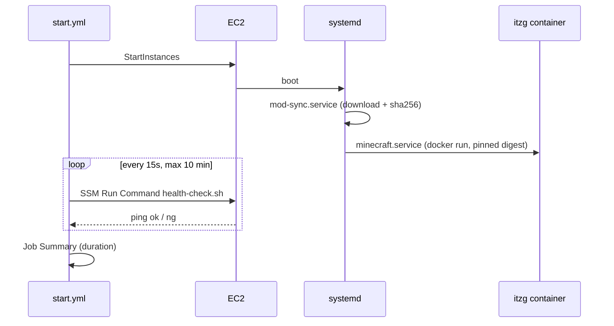

# Performance Design

上流: `aidlc/spaces/default/intents/261031-minecraft-aws-server/construction/nfr-requirements/performance-requirements.md`、`tech-stack-decisions.md`。

## 起動経路と時間配分（NFR3.1, NFR3.2）


<!-- Text fallback: start.yml がインスタンスを起動する。ブート後、systemd が mod-sync（ダウンロードと sha256 照合）を実行し、続けて minecraft.service（digest 固定のコンテナ）を起動する。start.yml は 15 秒ごとに最大 10 分、SSM Run Command で health-check.sh を実行し、server list ping の成功を待つ。最後に所要時間を Job Summary に書く。 -->

| 区間 | 目安 | 短縮の工夫 |
|---|---|---|
| EC2 起動〜SSM 応答 | 2 分 | AMI は Amazon Linux 2023 の最小構成。Docker は初回の user data でだけ導入し、以後は再起動のみ |
| MOD の同期 | 3 分 | sha256 が一致する jar はダウンロードしない（キャッシュは EBS 上の `/srv/minecraft/mods-cache/`）。並列ダウンロードは 4 本まで |
| コンテナの起動とワールド読み込み | 5 分 | イメージはワールド EBS 上の Docker data-root にキャッシュする。digest が変わらなければ再取得しない |

- ワールド用 EBS を `/srv/minecraft` にマウントし、Docker の data-root もそこに置きます。インスタンスを置き換えても、イメージと MOD のキャッシュを再利用できます。

## メモリと JVM（NFR2.4）

- 既定のヒープ上限 `MEMORY` は、インスタンスメモリの 75% です（16 GB なら 12G）。Terraform で `instance_type` からメモリを引いて計算し、`jvm_heap_override` 変数で上書きできるようにします。
- itzg の `USE_AIKAR_FLAGS=true`（G1GC の推奨フラグ集）を有効にします。

## CPU とアーキテクチャ（NFR2.5）

- `cpu_architecture` の既定は `arm64` です。AMI は `/aws/service/ami-amazon-linux-latest/al2023-ami-kernel-default-<arch>` から取得します。
- `instance_type` の許可リストは、アーキテクチャごとに `locals` で持ちます。組み合わせが合わない場合は、`validation` / `precondition` で plan を失敗させます。

```hcl
# 例（イメージ）
precondition {
  condition     = contains(local.allowed_types[var.cpu_architecture], var.instance_type)
  error_message = "instance_type is not allowed for the selected cpu_architecture."
}
```

## 人数と負荷（NFR2.1〜NFR2.3）

- `max-players`（既定 10）と `view-distance` / `simulation-distance` は設定ファイルで管理します。TPS が落ちたときは、まず `simulation-distance` を下げます（目安扱い。測定基盤は作りません）。

## Sources

- `nfr-requirements/performance-requirements.md` NFR2.1〜NFR2.5、NFR3.1〜NFR3.2
- `nfr-design-questions.md` [Q1] [Q3] [Q4]

## Assumptions & Open Questions

- [assumption] health-check のポーリング間隔は 15 秒とする。
- [assumption] MOD の並列ダウンロード数は 4 とする。
