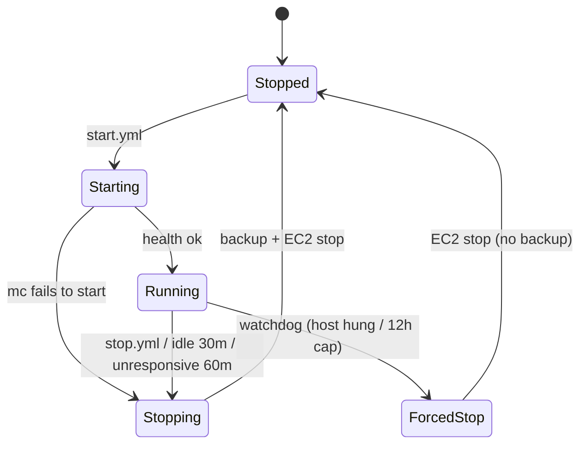

# Reliability Design

上流: `aidlc/spaces/default/intents/261031-minecraft-aws-server/construction/nfr-requirements/reliability-requirements.md`（NFR4.x, NFR9.x）、`observability-requirements.md`、`logical-components.md`。

## 1. サーバーの状態遷移

<!-- Text fallback: 停止中から start.yml で起動中に移り、ヘルスチェックが通れば稼働中になる。Minecraft が起動に失敗した場合は停止処理に移る。稼働中は stop.yml、無人 30 分、無応答 60 分で停止処理に移り、バックアップと EC2 停止を経て停止中に戻る。ホストが固まった場合や 12 時間の上限では watchdog が強制停止し、バックアップなしで停止中に戻る。 -->

## 2. 停止処理（stop.sh）

1. EC2 タグ `mc:stopping=true` を付けます。
2. ロックファイル `/srv/minecraft/.lock`（`flock`）を取得します。毎時バックアップは、このロックを取れなければスキップします（FR4.3 の AC4.3.3）。
3. RCON で `save-off` → `save-all flush` を実行します。
4. ワールドを `tar --zstd` で圧縮し、`stop/` に PUT します。アップロード後に sha256 を照合します。
5. `stop/` の世代が 8 以上なら、古いものから削除します。
6. コンテナを停止します（`docker stop -t 60`）。
7. 成否を SNS に送ります（バックアップの結果を含む）。失敗しても次へ進みます。
8. `aws ec2 stop-instances`（自インスタンス）を実行します。起動時の health スクリプトがタグ `mc:stopping` を外します。

手動の stop.yml は、SSM Run Command で同じ `stop.sh` を呼び、EC2 の状態が `stopped` になるまで待ちます。

## 3. バックアップ（backup-hourly）

- systemd timer（`OnCalendar=hourly`、`Persistent=false`）で実行します。
- `flock -n` でロックを取れない場合（停止処理中など）は終了します。
- 処理は `save-off` → `save-all flush` → 圧縮 → PUT → 照合 → `save-on` の順です。`save-on` は失敗時も `trap` で必ず実行します。
- `hourly/` の世代が 25 以上なら、古いものから削除します。
- 失敗したら `BackupFailures=1` を送り、SNS に送ります。サーバーは稼働を続けます。

## 4. 自動停止と無応答（idle-stop / health）

- `health.timer`（1 分ごと）が server list ping を送り、`ServerUp` と `PlayersOnline` を CloudWatch に送ります。人数と無応答の継続時間は、状態ファイル `/run/minecraft/state` に記録します。
- 人数 0 が 30 分続いたら `stop.sh`（理由: idle）を、無応答が 60 分続いたら `stop.sh`（理由: unresponsive）を呼びます。
- 起動直後は、ワールドの読み込みが終わるまで無応答とみなさないよう、最初の 10 分を猶予期間にします。

## 5. 外部 watchdog（ホストの外側）

- 5 分ごとに Lambda が `ec2:DescribeInstances`（タグ `mc:managed=true`）を実行し、`running` のインスタンスについて次を判定します。
  - (a) `GetMetricData` で取得した直近 60 分の `ServerUp` の最大値が 1 未満、または欠測で、`LaunchTime` から 60 分以上たっている
  - (b) `StatusCheckFailed` が直近 15 分すべて 1
  - (c) 起動から 12 時間以上たっている
- いずれかに当たり、タグ `mc:stopping=true` がなければ、`StopInstances` を実行して SNS に送ります。
- 単体テストでは、境界値（59/60 分、14/15 分、11:59/12:00）、`mc:stopping` が付いている場合、停止中の場合を確認します。

## 6. 置き換え時の保護（NFR4.13 / FR4.5）

- deploy.yml は、apply の前に plan JSON を読み、`aws_instance.minecraft` の actions に `delete` が含まれ、かつインスタンスが `running` なら、SSM で `stop.sh`（理由: replace）を実行して停止を待ちます。その後に apply します。
- 停止中なら、そのまま apply します。

## 7. 起動失敗（NFR4.8）

- `minecraft.service` が起動に失敗するか、mod-sync が失敗した場合、start.yml の health 待ちは失敗します。start.yml は失敗ステップで次の順に処理してから終了します。
  1. SSM が応答する場合は、`stop.sh`（理由: start-failed）を呼びます。
  2. SSM が 3 分以内に応答しない場合（ブートの失敗やエージェントの未起動）は、`ci-ops` の `ec2:StopInstances` で直接停止します（フォールバック）。
  3. どちらの場合も、`ci-ops` から SNS に起動失敗を送ります。
- mod-sync は、どの MOD がなぜ失敗したかを journald と SNS に出します。

## 8. 復元（restore.yml）

- 入力はバックアップのキー（`stop/…` または `hourly/…`）です。インスタンスが `stopped` でなければ失敗します（FR6.5 の AC6.5.2）。
- restore.yml（`ci-ops`）はタグ `mc:mode=restore` を付けてからインスタンスを起動します。タグの操作は `aws:TagKeys` 条件で `mc:mode` だけに限ります（security-design.md §2）。
- 起動時に `boot-mode.service` が自インスタンスのタグを読み（`ec2:DescribeTags`）、`mc:mode=restore` であれば `minecraft.service` を起動しない `restore.target` に切り替えます。
- SSM で `restore-apply.sh <key>` を実行します。処理はダウンロード → sha256 照合 → 現在のワールドを `world.pre-restore/` に退避 → 展開です。
- 終わったら restore.yml が `mc:mode` タグを外し、インスタンスを停止します。restore.yml が途中で失敗した場合も、`always()` のステップでタグを外して停止します。続けて start.yml で起動すると、復元したワールドで遊べます。

## 9. 通知の信頼性（NFR4.11）

- notifier Lambda は、Discord への POST に 5 秒のタイムアウトと最大 2 回の再試行（指数バックオフ＋ジッター）を設けます。HTTP 429 のときは `retry_after` に従います。
- 最終的に失敗したら、例外を投げて CloudWatch Logs に残します。メール購読は Lambda と独立しているので、メールには届きます。

## 10. 誤削除の防止（NFR4.6）

- `aws_eip`、ワールド用の `aws_ebs_volume`、バックアップ用の `aws_s3_bucket` に `lifecycle { prevent_destroy = true }` を付けます。テストでは plan JSON を見て確認します。
- ワールド EBS とインスタンスは、`aws_volume_attachment` で分離します。インスタンスの置き換えではボリュームを削除しません。

## Sources

- `nfr-requirements/reliability-requirements.md` NFR4.1〜NFR4.13、NFR9.1〜NFR9.4
- `nfr-requirements/observability-requirements.md` NFR7.1、NFR7.2、NFR7.9、NFR7.9a
- `nfr-design-questions.md` [Q3] [Q4]

## Assumptions & Open Questions

- [assumption] 起動直後の猶予期間は 10 分とする。
- [assumption] 復元は、起動ターゲットを切り替える方式で行う。
