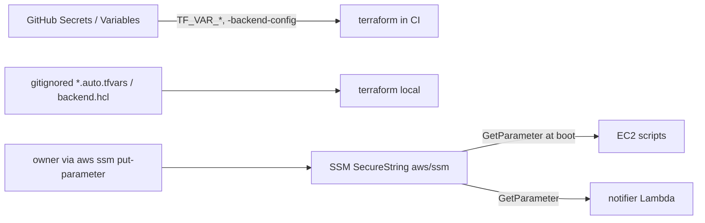

# Security Design

上流: `aidlc/spaces/default/intents/261031-minecraft-aws-server/construction/nfr-requirements/security-requirements.md`（NFR5.x, NFR6.x）、`tech-stack-decisions.md`、`logical-components.md`。

## 1. 防御の層

| 層 | 対策 | 対応する要件 |
|---|---|---|
| GitHub | `workflow_dispatch` は書き込み権限のある人だけが実行できる。各ジョブに `if: github.actor == vars.OPERATOR_LOGIN` を付ける。Environment `prod` は承認必須、`ops` は `master` からのみ実行できる。fork PR には OIDC トークンを発行しない。`permissions` は最小限にし、action は SHA で固定する | NFR5.2c, NFR5.3, NFR5.14 |
| AWS への入口 | OIDC の 3 ロール。`aud` / `sub` は `StringEquals` で指定し、Environment 単位で縛る | NFR5.1, NFR5.2 |
| AWS 内の権限 | permissions boundary を必須にし、`${prefix}-app-*` だけを作成・変更できるようにする。PassRole は ec2 / lambda に限る。`${prefix}-ci-*` は明示的に Deny する | NFR5.2b, NFR5.2d |
| ネットワーク | SG の ingress は 25565/TCP だけ。SSH なし（SSM Session Manager を使う）。RCON はコンテナ内の localhost だけで待ち受ける | NFR5.5, NFR5.6, NFR5.8 |
| ホスト | IMDSv2 を必須にし、ホップ制限は 2。EBS を暗号化する | NFR5.7, NFR5.9 |
| ゲーム | `online-mode=true`、`white-list=true`、`enforce-whitelist=true` | NFR5.8 |
| データ | S3 は BPA、SSE、TLS 強制、バージョニング、`prevent_destroy` を設定する。state バケットも同じ | NFR5.10, NFR5.11 |
| サプライチェーン | イメージは digest で固定する。MOD は sha256 を照合する（mod-sync）。action は SHA で固定する | NFR5.12〜NFR5.14 |
| 秘匿 | 識別子は Secrets / Variables と gitignore したファイルにだけ置く。実行時の秘匿値は SSM SecureString（`aws/ssm`）に置く。ログ・PR コメント・Discord には出さない。CI の識別子チェックと gitleaks で検出する | NFR6.1〜NFR6.5 |

## 2. IAM ロールの設計

| ロール | 作成場所 | trust（`sub`） | 主な権限 | 検証 |
|---|---|---|---|---|
| `${prefix}-ci-plan` | bootstrap | `repo:<repo>:pull_request` | state の Get / List、`*.tflock` の Put / Delete、ReadOnly 系の Describe / Get / List | `bootstrap/tests/iam.tftest.hcl` |
| `${prefix}-ci-apply` | bootstrap | `repo:<repo>:environment:prod` | 対象サービスの CRUD。IAM は `${prefix}-app-*` だけで、作成時は boundary が必須。`${prefix}-ci-*` への `iam:*` は Deny。通知用 SNS トピックへの `sns:Publish`（スモークテスト失敗の通知用） | 同上 |
| `${prefix}-ci-ops` | bootstrap | `repo:<repo>:environment:ops` | タグ `mc:managed=true` の EC2 に対する Start / Stop / Describe。指定ドキュメントだけの `ssm:SendCommand` / `GetCommandInvocation`。`mc:managed=true` の EC2 に対して、タグキー `mc:mode` だけの `ec2:CreateTags` / `ec2:DeleteTags`（`aws:TagKeys` 条件。復元用）。通知用 SNS トピックだけへの `sns:Publish`（ホストに届かない起動失敗の通知用） | 同上 |
| `${prefix}-app-server` | envs/prod | ec2.amazonaws.com | `hourly/` と `stop/` への S3 Get / Put / Delete / List、バケット全体への `s3:ListBucketVersions`（容量の集計用。読み取りのみ）、自分の SSM パラメータの Get、`kms:Decrypt`（`kms:ViaService=ssm`）、CloudWatch の PutMetricData（名前空間 `Minecraft`。CloudWatch Agent の `metrics_namespace` も `Minecraft` にそろえる）、Logs への書き込み、自インスタンスの `ec2:StopInstances`、`mc:stopping` タグに限った Create / DeleteTags、`ec2:DescribeTags`（自インスタンスの `mc:mode` を読むため）、通知用 SNS トピックだけへの `sns:Publish`、SSM Core | `modules/minecraft_server/tests/` |
| `${prefix}-app-watchdog` | envs/prod | lambda.amazonaws.com | Describe 系、タグ付き EC2 の Stop、`cloudwatch:GetMetricData`、SNS の Publish、Logs | `modules/watchdog/tests/` |
| `${prefix}-app-notifier` | envs/prod | lambda.amazonaws.com | Webhook パラメータの `ssm:GetParameter`、`kms:Decrypt`（ViaService 付き）、Logs | `modules/notifier/tests/` |

- `<repo>`（owner/name）、`${prefix}`、アカウント ID は、すべて変数で渡します。trust policy の ARN は `data.aws_caller_identity` と `data.aws_partition` から組み立てます。

## 3. 秘匿値の流れ

<!-- Text fallback: GitHub Secrets / Variables は TF_VAR_* と -backend-config として CI の terraform に渡る。手元の terraform には gitignore したファイルから渡る。実行時の秘匿値は、本人が aws ssm put-parameter で SSM SecureString に登録し、EC2 のスクリプトは起動時に、通知 Lambda は送信時に GetParameter で読む。 -->

- whitelist は SSM から読み、起動時に itzg の `WHITELIST` 環境変数で注入します。`docker run` の引数はログに出さず、`--env-file`（root のみ読める 0600 のファイル）を使います。
- RCON パスワードも同じ `--env-file` で渡します。RCON のポートはホストに publish しません。

## 4. ログ・PR・通知での漏洩防止

- **plan サマリー**: `terraform show -json` から、各リソースアドレスの件数（作成・変更・削除・置換）だけを抜き出して投稿します。値（`after` / `before`）は一切出しません。
- **ジョブの最初のステップ**: `TF_VAR_*` に入る識別子（アカウント ID、ロール ARN、バケット名、`<repo>`）と、`aws sts get-caller-identity` の結果を `::add-mask::` に登録します。
- **Terraform の output**: `sensitive = true` を付け、CI では `terraform output` を実行しません。
- **Discord 通知**: Lambda は送信前に本文を正規表現で検査します（ARN、12 桁、IPv4、`i-` から始まる ID）。検出した場合は送信を中止してエラーにします。この挙動は pytest で検証します。

## 5. CI の必須チェック（11 種）

`terraform fmt -check`、`terraform validate`、tflint、Checkov、`terraform test`、`terraform plan`、pytest、識別子チェック、gitleaks に、NFR Design の [Q3]（Bash を採用）で次の 2 つを加えます。

- ShellCheck: Bash スクリプトの静的検査
- bats: Bash スクリプトのテスト

bats では、外部コマンド（`aws`、`docker`、`rcon-cli`、`curl`）をスタブに差し替え、次の点を検証します。
- `flock` による排他
- 失敗時も `trap` で `save-on` が実行されること
- 世代削除の境界（短期 24 / 25 世代、停止時 7 / 8 世代）
- sha256 不一致のときに配置しないこと
- 無人 29 / 30 分、無応答 59 / 60 分の境界

各スクリプトには、正常系に加えて異常系・境界のケースを 2 つ以上置きます（construction ガードレール）。

## Sources

- `nfr-requirements/security-requirements.md` NFR5.1〜NFR5.14、NFR6.1〜NFR6.5
- `nfr-design-questions.md` [Q1]〜[Q4]

## Assumptions & Open Questions

- ShellCheck と bats を必須チェックに加え、合計 11 種とする（承認前の確認で本人が決定）。
- 通知の送り手は 2 つにする。ホスト上のスクリプト（`app-server`）と、ホストに届かない場合の start / stop ワークフロー（`ci-ops`）。どちらも同じ SNS トピックに同じ JSON 形式で送る（observability-design.md §3）。
